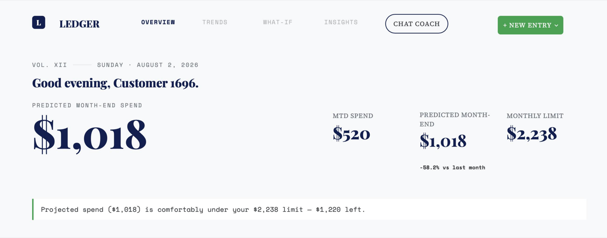
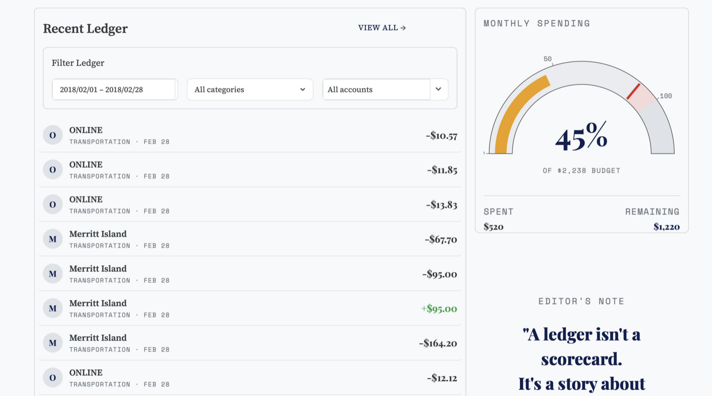
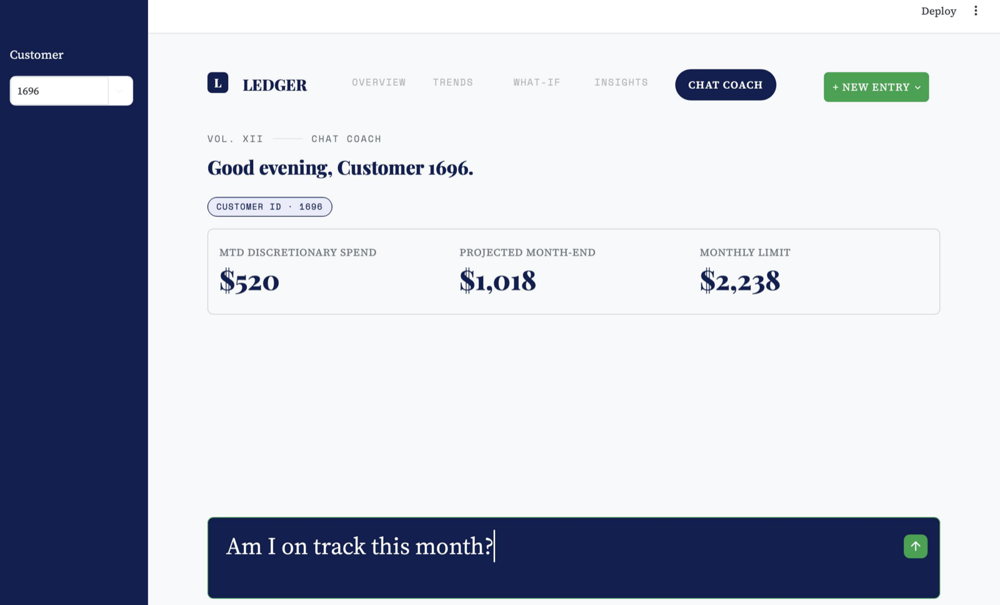

# ClearLedger — Personal Finance Coach & Spending Analyzer

> An AI-powered personal-finance coach: it categorizes your card spending with an LLM, predicts
> your month-end spend with machine learning, and coaches you — in plain language, grounded in
> your own numbers — to stay under your monthly limit.

[](https://clearledger.streamlit.app)


**▶ Live demo: [clearledger.streamlit.app](https://clearledger.streamlit.app)** — explore the
full dashboard for customer 1696, right in your browser (no setup).



## 1. Introduction

**ClearLedger** is a Python + Streamlit application that turns a user's raw card-transaction
history into a personal finance coach. ClearLedger (a fintech with high early-user churn) needs
to deliver value fast; this app does that by making spending legible and coaching users to stay
within their monthly discretionary limit.

For a selected customer (deliverables target **user id 1696**) the app:
- **ingests & cleans** four raw data sources (transactions, cards, users, MCC codes),
- **categorizes** every transaction into human-readable spending buckets using an **LLM**
  (the 109 merchant-category codes are classified once and cached),
- **predicts** month-end discretionary spend with a **scikit-learn regression** model and
  compares it to the user's limit,
- presents an **interactive dashboard** (limit meter, month-to-date vs. projected spend,
  category trend chart, spending breakdown, recommendations), and
- offers a **multi-turn chat coach** whose answers are grounded in the user's own numbers.

**Enhancements:** unusual-charge detection, recurring/subscription finder, and a "what-if"
savings slider.

**Spending meter & live ledger** — a budget gauge, month-to-date vs. projected spend, and a
filterable transaction ledger:



**Chat coach** — a multi-turn assistant whose answers are grounded strictly in the user's real numbers:



## 2. Project Structure

```
personal-ai-finance-coach/
├── data/                       # sanitized single-customer demo dataset + cache (see data/README.md)
│   ├── transactions.csv        # customer 1696 only (~30k rows); no card numbers
│   ├── users.csv, cards.csv    # customer 1696; card_number/cvv/address removed
│   ├── mcc_codes.json          # merchant-category code reference
│   └── processed/
│       └── mcc_category_map.json      # generated: cached MCC→bucket mapping
├── src/                        # reusable, tested modules
│   ├── config.py               # loads config.yaml + .env
│   ├── data_loader.py          # load, clean, join, filter (Module 1)
│   ├── categorize.py           # LLM categorization + cache + fallback (Module 2)
│   ├── features.py             # monthly feature engineering + trend data (Module 3)
│   ├── predict.py              # regression training + month-end projection (Module 3)
│   ├── recommend.py            # category savings recommendations (Module 4)
│   ├── coach.py                # grounded chat logic (Module 5)
│   └── insights.py             # unusual charges + recurring merchants (Module 6)
├── app/                        # Streamlit UI
│   ├── _shared.py              # cached load/train pipeline shared by both pages
│   ├── app.py                  # entry point: top-nav router (st.navigation)
│   ├── theme.py                # shared CSS/palette/UI helpers
│   └── pages/
│       ├── 1_Overview.py       # dashboard content (dispatched by the router)
│       └── 2_💬_Chat_Coach.py  # chat coach (second page; emoji in filename = its nav icon)
├── tests/                      # pytest suites (34 tests)
├── assets/                     # screenshots used in this README
├── config.yaml                 # paths, reference_day, seed, target user
├── .env.example                # API key/endpoint template (copy to .env)
├── requirements.txt            # pinned dependencies
├── PROJECT_SPEC.md             # full technical specification
├── CHAT_TRAIL.md               # AI-assisted development record
└── README.md                   # this file
```

## 3. Execution Steps

From the project root:

```bash
# 1. Create an isolated environment (Python 3.12) and install dependencies
python3.12 -m venv .venv
source .venv/bin/activate            # Windows: .venv\Scripts\activate
pip install -r requirements.txt

# 2. Configure API access (LLM used for categorization + chat)
cp .env.example .env                 # then edit .env:
#    LLM_API_KEY   = <your key>
#    LLM_BASE_URL  = https://aibe.mygreatlearning.com/openai/v1   (gateway) or blank for OpenAI
#    LLM_MODEL     = gpt-4o-mini

# 3. (Optional) run the test suite
pytest                               # 34 tests

# 4. Launch the app
streamlit run app/app.py             # opens http://localhost:8501
```

- The **dashboard** (Overview) and **Chat Coach** are the two tabs in the top navigation bar.
- On first run the app auto-generates the categorization cache (one LLM call) if it is missing;
  after that it runs offline from the cache.
- Without a working API key, categorization and chat fall back to a deterministic rule-based
  mode so the app still runs end-to-end.
- A sanitized single-customer **demo dataset** (customer 1696) is included, so the app runs out of
  the box with **no API key** (categorization uses the committed cache; the chat coach needs a key
  and otherwise shows a friendly notice). On the public demo the key lives in Streamlit Cloud
  Secrets and chat is **rate-limited to 10 questions per hour per visitor**. The full multi-user dataset is not included (size +
  privacy). See [`data/README.md`](data/README.md).

## 4. Output Files

| File | Generated by | Contents |
|---|---|---|
| `data/processed/mcc_category_map.json` | first run of `categorize.py` / the app | cached `{MCC code → spending bucket}` mapping (109 entries) |
| Trained regression model | held in memory (Streamlit cache) at runtime | month-end spend predictor (not persisted to disk) |
| App screenshots | the running app for user 1696 | see [`assets/`](assets/) (shown at the top of this README) |

## 5. Guardrails

The app fails safely and never trusts unvalidated input:

- **Schema checks** — required columns are verified on load; a missing column raises a clear error.
- **Safe parsing** — currency text (`"$1,755"`) is converted to numbers; blanks/garbage become
  `NaN` rather than crashing.
- **User existence** — requesting a user with no transactions raises an explicit error.
- **LLM output validation** — the model's categories are checked against a fixed allowed list;
  any missing/invalid code falls back to a deterministic keyword rule, so the mapping is always
  complete and valid.
- **API resilience** — the whole LLM path is wrapped so an API failure degrades to the offline
  fallback (categorization) or a friendly message (chat) instead of breaking the app.
- **Tolerant JSON parsing** — LLM responses wrapped in markdown/prose are still parsed correctly.
- **Prediction sanity** — projected month-end spend can never fall below money already spent.
- **Grounded coaching** — the chat coach is instructed to use only the user's real figures and
  decline off-topic or fabricated-number requests.
- **Secret hygiene** — the API key lives only in `.env` (git-ignored) or Streamlit Cloud Secrets; never hard-coded.
- **Cost guardrail** — the public demo's chat is rate-limited per visitor session, backed by a
  hard spending cap on the API account.

## 6. How this was built (AI-assisted)

ClearLedger was built with an AI pair-programmer (Claude) inside PyCharm, using a plan-first,
test-as-you-go workflow. The full development story — the planning prompt, the build milestones,
the guardrails, and where the AI's output was reviewed and corrected — is documented in
**[`CHAT_TRAIL.md`](CHAT_TRAIL.md)**.
